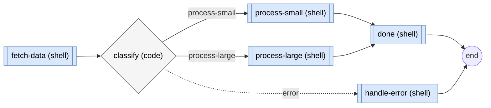

pflow provides a CLI for running workflows, managing MCP servers, and configuring settings.

<Note>
  **Who runs these commands?** Most pflow commands are run by your AI agent, not by you directly. You handle setup (installation, API keys, MCP servers), then your agent uses pflow to build and run workflows. This reference documents all commands so you understand what your agent is doing. See [Using pflow](/guides/using-pflow) for what to expect day-to-day.
</Note>

## Command structure

```bash
pflow [command] [options] [arguments]
```

## Command groups

<Columns cols={2}>
  <Card title="pflow (default)" icon="circle-play" href="#main-command">
    Run workflows by name or file
  </Card>
  <Card title="pflow list / find / describe" icon="workflow" href="/reference/cli/list">
    Find saved workflows and inspect them by saved name or file path
  </Card>
  <Card title="pflow skill" icon="wand-magic-sparkles" href="/reference/cli/skill">
    Publish workflows as AI agent skills
  </Card>
  <Card title="pflow guide / probe" icon="box" href="/reference/cli/guide">
    Learn the surface and test single nodes
  </Card>
  <Card title="pflow mcp" icon="plug" href="/reference/cli/mcp">
    Manage MCP server connections
  </Card>
  <Card title="pflow settings" icon="file-cog" href="/reference/cli/settings">
    Configure API keys and node filtering
  </Card>
  <Card title="pflow ui" icon="app-window" href="#ui-command">
    Interactive browser canvas for a workflow
  </Card>
  <Card title="pflow mermaid" icon="git-graph" href="#mermaid-command">
    Generate a Mermaid flowchart from a workflow
  </Card>
  <Card title="pflow guide" icon="book-open" href="/reference/cli/guide">
    Get AI agent entry guidance
  </Card>
</Columns>

## Main command

The default `pflow` command runs workflows. Your agent uses this to run saved workflows or workflow files it has created.

### Run a saved workflow

```bash
pflow my-workflow input=data.txt threshold=0.5
```

### Run from a file

```bash
pflow ./workflow.pflow.md
pflow ~/workflows/analysis.pflow.md param=value
```

<Info>
  **No built-in natural language mode.** pflow executes workflow files and saved workflows. Your AI agent builds workflows using pflow's MCP tools or CLI primitives — pflow doesn't have its own natural language interface.
</Info>

## Resume a failed run

When a run fails partway — an LLM/HTTP/MCP step times out, a transient error survives retries — `pflow resume` continues from the failed step instead of re-running the whole workflow. It restores the already-completed upstream steps' outputs from the saved trace (it does not re-run them) and walks forward from the failed step.

```bash
pflow resume 7a9e4afb-2095-447e-8043-0660438104f9   # resume that exact failed attempt
pflow resume my-workflow                             # resume the newest failed run of a workflow
pflow resume my-workflow api_url=https://fixed.example.com   # override an input while resuming
```

The failed run prints the exact command to use (`To resume from the failed step: pflow resume <execution-id>`). A resumed run is a new run with its own trace, linked to the original.

| Option | Description |
|--------|-------------|
| `--force` | Consent to re-running steps: bypass the side-effect confirmation and the edited-workflow check. A denial is never edit-checked; `--force` only overrides its refusal of a reference to a step with no saved output |
| `--dry-run` | Preview the resumed tail's cost and cache plan (from the failed step onward) without running |
| `KEY=VALUE` | Override the original run's inputs |

The failed step runs again from the start (a loop step: its failed iteration — completed iterations are restored), so if it already partly side-effected (an HTTP POST that sent but timed out on the response), resuming re-fires it — at-least-once execution. A side-effecting step (`shell`/`code`/`agent`/file-ops/`mcp`) asks for confirmation at a terminal and refuses for non-interactive agents unless you pass `--force`; an idempotent `llm` step, or a step that failed resolving its templates before it started, resumes silently. Editing the failed step or anything after it — or any step's description — needs no flag: fix the failed step, then resume. Resume refuses, naming what changed, only when the edit touches a step whose saved output it restores — edited, removed, now leading somewhere else (a step inserted before the resume point), a different start step, or an approval step edited after it was approved; re-run from the start, or pass `--force` to keep the saved outputs (the refusal names any inserted step that would be skipped). An edited `## Inputs` default does not affect a resume (the original inputs are reused) — pass `KEY=VALUE`. Edits inside a sub-workflow step's child file are not checked. Resume also refuses when a step it would restore returned a non-JSON-native result (a set, date, `Decimal`, bytes, non-string keys) — make that result JSON-native (`str(dt)`, `sorted(s)`) or re-run from the start. See [`pflow guide resume`](/reference/cli/guide) for the full behavior (loop continuation, gate re-prompting, top-level granularity, interrupted-run handling).

## Answer a paused gate

An [approval gate](/how-it-works/approval-gates) reached in a non-interactive run — a pipe, CI, an MCP call, a browser-launched run — doesn't fail and doesn't hang. The run **pauses**, saves its state to the trace, and exits with code **4** with a resume token on stdout:

```
Paused at 'notify-slack'. Resume token: 7a9e4afb-2095-447e-8043-0660438104f9 (exit 4)
```

The gate's content follows on stderr — an approval's resolved preview, or an escalation's question, options, and recommendation — so a calling process can compose the answer from the output alone. With `--output-format json`, the paused run prints the same document every run ending prints (see [JSON mode](#json-mode)) with `status: "paused"`, an empty `errors`, `gate` (the gated step's `node_id` and its content) and `resume_command` — the exact answer command.

Answer it later — hours or days on — and the run continues from the gated step without re-running anything upstream:

```bash
pflow resume 7a9e4afb-2095-447e-8043-0660438104f9 --approve yes        # run the gated step and continue
pflow resume 7a9e4afb-2095-447e-8043-0660438104f9 --approve no         # deny cleanly (exit 3), no side effects
pflow resume 7a9e4afb-2095-447e-8043-0660438104f9 --choose "per-env"   # answer an escalation (or --choose 2)
pflow resume list                                                      # pending pauses waiting for an answer
```

| Option | Description |
|--------|-------------|
| `--approve yes\|no` | Answer an approval gate — run the gated step, or deny and end the run |
| `--choose "<answer>"` | Answer an agent escalation — free text, or an option number from the question |
| `resume list` | List pending unanswered pauses (token, workflow, gated step, gate kind, age) |

Nothing upstream re-runs — completed steps are restored from the paused trace. An approval gate fires *before* its step, so an approved step runs for the first time (no confirmation prompt, no re-fired side effect); an answered escalation continues after its step with the decision folded in — the next step, or for a loop step its next iteration or its exit — so the agent step is never re-paid. A loop step's gate pauses at each iteration as a new token, and the pause output names it with the step's limit (`Loop iteration 2 of up to 3`); `--approve yes --auto-approve <step>` approves that iteration and every remaining one. Answering consumes the token: the resumed attempt supersedes the paused run, and a second answer refuses and names the newer attempt. Resuming without an answer flag refuses and prints the pending question with the exact command. The edited-workflow refusal and `--force` apply the same as a failed resume — and editing the gated step after approving it refuses too: the approval covered the version shown. A denial runs nothing, so the edited-workflow check never refuses it (the workflow must still be valid); what it needs is the paused gate — if that step was renamed, removed, no longer reachable from the start, or lost its `approval: required`, the denial refuses (no gate is left to deny, and resuming could run the step), and `--force` does not override that. The paused step's `${...}` references resolve before its gate fires, so a denial also refuses when that step now reads a step with no saved output from before the pause; if the reference cannot fail (a fallback to a literal like `${x.y ?? ""}`, permissive template mode), pass `--force` to deny anyway.

<Note>
  Durable pause needs the trace. A gate under `--no-trace`, inside a parallel batch item, in a sub-workflow child, or in an inline/piped workflow (no file to reload) can't pause — it fails at the gate instead. Save the workflow to a file and run it by name or path so its gates can pause.
</Note>

## Global options

| Option | Description |
|--------|-------------|
| `--version` | Show pflow version — an editable install of a source checkout appends its commit (`0.16.0+g93798a80`, `.dirty` with uncommitted changes to tracked files) |
| `-v, --verbose` | Show detailed execution output |
| `-o, --output-key KEY` | Specific shared store key to output |
| `--output-format text\|json` | Output format (default: text) |
| `-p, --print` | Minimal output: suppress header, summary, and warnings |
| `--no-trace` | Disable workflow trace saving |
| `--cache/--no-cache` | Enable/disable memoization cache reads (default: enabled) |
| `--only NODE` | Re-run just this node against a snapshot of the last full run (upstream restored, not re-executed; needs a prior full run) |
| `--auto-approve NODE` | Pre-approve one approval gate by step name — every iteration of a loop step (repeatable; no approve-all form). See [Approval gates](/how-it-works/approval-gates) |
| `--validate-only` | Validate workflow without running |
| `--dry-run` | Preview which nodes would run or serve from cache, without executing |
| `--help` | Show help message |

<Note>
  Older natural-language workflow generation flags have been removed. Use the current global options shown above, or let your AI agent build `.pflow.md` workflows directly.
</Note>

## Parameter syntax

Pass parameters to workflows using `key=value` syntax:

```bash
pflow my-workflow input=data.txt count=10 enabled=true
```

**Types come from the workflow's `## Inputs`:** each `name=value` is read by its input's declared type, so `zip=02134` on a `string` input stays `02134`, and `count=3.0` on an `integer` input fails with `Invalid input value` before any step runs. An input declared `any` (or with no `type`) is typed only when the text reads back unchanged: `true` → boolean, `10` → integer, `'["a","b"]'` → array, `'{"key":"val"}'` → object; `02134`, `1.10` and everything else stay strings.

`--validate-only` with values checks them the same way (the CLI only — MCP `workflow_validate` takes no parameters).

## Stdin input

Pipe data into workflows that declare an input with `stdin: true`:

```bash
echo "test content" | pflow my-workflow
cat data.csv | pflow csv-analyzer
```

The workflow must have an input marked to receive stdin:

```markdown
## Inputs

### data

Data input from stdin pipe.

- type: string
- required: true
- stdin: true
```

Piped data routes to this input automatically, and a file redirect works the same way (`pflow my-workflow < data.csv`). pflow reads stdin only for this input: a workflow with no `stdin: true` input never reads it, so piping into one is ignored, not an error. CLI parameters override stdin if both are provided, and stdin is then left unread:

```bash
# CLI parameter wins - "override" is used, not piped content
echo "piped" | pflow my-workflow data="override"
```

For workflow chaining, use the `-p` flag to output results for the next workflow:

```bash
pflow -p step1 | pflow -p step2 | pflow step3
```

## Stdout output

Workflows that declare multiple outputs mark one with `stdout: true` to pick which output lands on process stdout in text mode:

```markdown
## Outputs

### message

Primary result — streams to stdout on redirect or pipe.

- source: ${emit.stdout}
- stdout: true

### length

Secondary metadata. Available via `-o length` or `--output-format json`.

- source: ${count.stdout}
```

Redirecting or piping the CLI in text mode now writes only the marked output to stdout:

```bash
pflow stdout-result.pflow.md > result.txt       # file contains the message only
pflow stdout-result.pflow.md | next-step        # message streams to the next command
pflow stdout-result.pflow.md -o length          # override: emit length instead
pflow stdout-result.pflow.md --output-format json   # emit all outputs as structured JSON
```

Single-output workflows don't need the marker — their one output is unambiguous. Workflows with multiple declared outputs and no `stdout: true` stream the first declared output and print a warning on stderr naming the other outputs and the three ways to change the routing: add the marker, pass `-o`, or switch to JSON mode. The validator enforces that at most one output per workflow is marked.

## Output modes

### Text mode (default)

Human-readable output with live progress streamed to stderr and results on stdout. Works the same way in a terminal, CI log, agent bash tool, or subprocess capture:

```bash
pflow workflow.pflow.md
```

Progress lines and execution summary go to stderr. Declared workflow outputs go to stdout.

### JSON mode

Structured output on stdout for machine parsing:

```bash
pflow --output-format json workflow.pflow.md
```

Every way a run ends — success, failure, a paused gate, a denied gate — prints one document with one shape on stdout; `status` says which. Progress and the execution summary go to stderr (suppressed with `-p`, which never changes the document).

<Expandable title="JSON output structure">

**Success:**

```json
{
  "success": true,
  "status": "success",
  "workflow": {"action": "unsaved", "name": "/path/to/report.pflow.md"},
  "execution_id": "75b7b20d-3513-4ba7-8ac8-21374cb106a6",
  "trace_path": "/home/you/.pflow/debug/workflow-trace-aa1da5d4-report-20261012-012756-179612.json",
  "result": {"verdict": "two-value"},
  "errors": [],
  "warnings": [],
  "advisories": [],
  "diagnostics": [],
  "duration_ms": 37.8,
  "total_cost_usd": 0.0,
  "metrics": {
    "workflow": {"duration_ms": 34.92, "cost_usd": 0.0, "tokens_total": 0, "models_used": [], "node_timings": {"one": 9.78, "two": 9.03}},
    "total": {"tokens_total": 0, "total_calls": 0, "cost_usd": 0.0}
  },
  "execution": {
    "duration_ms": 37.8,
    "nodes_executed": 2,
    "nodes_total": 2,
    "steps": [
      {"node_id": "one", "status": "completed", "duration_ms": 9.78, "cached": false},
      {"node_id": "two", "status": "completed", "duration_ms": 9.03, "cached": false}
    ]
  }
}
```

**Failure** (the same keys, plus `error` and, when the failed step can be resumed, `resume_command`):

```json
{
  "success": false,
  "status": "failed",
  "workflow": {"action": "unsaved", "name": "/path/to/report.pflow.md"},
  "execution_id": "b1473c07-7a53-41a4-8f47-47d3b0d24c38",
  "trace_path": "/home/you/.pflow/debug/workflow-trace-863aff80-report-20261012-012756-628402.json",
  "error": "Command failed with exit code 1: boom",
  "errors": [
    {
      "severity": "error",
      "message": "Command failed with exit code 1: boom",
      "source": "runtime",
      "title": "Execution Failed",
      "node_id": "two",
      "context": {"category": "execution_failure", "shell_command": "echo boom >&2; exit 1", "shell_exit_code": 1, "shell_stderr": "boom"}
    }
  ],
  "warnings": [],
  "advisories": [],
  "diagnostics": [ "…the errors, then the warnings and advisories…" ],
  "duration_ms": 29.42,
  "total_cost_usd": 0.0,
  "metrics": { "…as on success…" },
  "execution": {
    "duration_ms": 29.42,
    "nodes_executed": 1,
    "nodes_total": 2,
    "steps": [
      {"node_id": "one", "status": "completed", "duration_ms": 8.15, "cached": false},
      {"node_id": "two", "status": "failed", "duration_ms": 6.96, "cached": false}
    ]
  },
  "resume_command": "pflow resume b1473c07-7a53-41a4-8f47-47d3b0d24c38"
}
```

**Key fields:**

| Field | Description |
|-------|-------------|
| `success` | `true` when the run completed (exit 0, `status` `success` or `degraded`); `false` when it failed, paused or was denied — branch on `status` to tell those apart |
| `status` | `success`, `degraded` (completed with warnings), `failed`, `paused` or `denied` |
| `execution_id`, `trace_path` | The run's id and its trace file — present together whenever the trace was written (absent under `--no-trace`). Pass `trace_path` to `pflow report` |
| `result` | Workflow output (object, string, or array based on declared outputs). On failure, present only when a declared output failed to resolve: it holds the outputs that did |
| `error` | One-line summary of the failure or denial |
| `errors[]` | The failure's error diagnostics — always a list, empty on success and on a pause: `message`, `title`, `suggestions`, `node_id`, and the details under `context` (e.g. `context.available_fields` — valid fields for a template variable) |
| `diagnostics[]` / `warnings[]` / `advisories[]` | Every diagnostic, the warnings, and the non-degrading notes — same entry shape as `errors[]` |
| `duration_ms` | Total execution time in milliseconds (absent when the run failed before it started) |
| `total_cost_usd` | LLM API cost (0.0 if no LLM calls; `null` when a call's cost is unknown — `pricing_available`/`subscription` say why) |
| `execution.nodes_executed` | Steps completed in this run — steps restored by a resume or `--only` are not counted |
| `execution.cache_hits` | Number of nodes served from memoization cache |
| `execution.resumed_from`, `execution.nodes_restored` | On a resumed run: the run it resumed and how many upstream steps it restored |
| `gate` | Paused or denied at an approval gate: the gate's `node_id`, `kind` and content (secrets masked) |
| `resume_command` | The exact next command: `pflow resume <id>` on a resumable failure, the `--approve`/`--choose` answer on a pause |

Values under a sensitive name (`token`, `password`, `authorization`, `cookie`, …) print as `<REDACTED>` at any depth of a diagnostic, in every JSON document — a run's result, a pause, a denial, `--validate-only`, and `--dry-run`. The trace keeps them raw for `pflow resume`; `pflow report` masks them too.

</Expandable>

### Print mode (`-p`)

Minimal stderr output when you want the cleanest possible data stream:

```bash
pflow -p workflow.pflow.md | jq '.data'
```

Suppresses the "Workflow output:" header, the execution summary, warnings, and the trace line. What you must act on still prints to stderr: a failure's errors and resume command, a pause's gate and answer command, a denial, and the `⤷` resume/`--only` mode lines. Data still goes to stdout (same as default mode). Useful for piping into tools that should only see the result.

## Exit codes

The exit code tells a wrong call apart from a failed job. The difference is whether the run started, not what kind of error it was.

| Code | Meaning | What to do |
|------|---------|------------|
| `0` | Workflow completed, including runs that completed with warnings (`status: "degraded"`) | — |
| `1` | The run started and failed: a step failed (a shell exit code, an HTTP error, a raised exception), an output could not resolve, a sub-workflow refused a value at run time, or `--only` found no earlier full run to restore from | Read the errors and fix the step or its data; when the output prints a `resume_command`, it resumes from the failed step |
| `2` | The call was refused before the run started: the workflow file or name did not resolve, an unknown or misplaced flag, a missing or mistyped input, a validation or compile error, an unknown `--only` step, a `--validate-only` or `--dry-run` that found errors, or a `pflow resume` that was refused | Fix the call or the workflow, then run again. Nothing ran |
| `3` | Denied at an approval gate — a human said no; nothing after the gate ran | — |
| `4` | Paused at a gate (an approval or an escalation) — the resume token is on stdout | Answer with the command it prints (`--approve yes\|no`, or `--choose` for an escalation) |
| `130` | Workflow interrupted | — |

Exit `2` is also what pflow's argument parser returns for a bad option value (`--output-format xml`), so one code means "the call was wrong" whichever layer caught it. With `--output-format json`, a refused run or resume prints a document with `status: "failed"`, just like a failed run's; only the exit code tells them apart. `--validate-only` and `--dry-run` print their own documents (see those sections). An error the argument parser itself catches (a bad option value, an unknown `pflow resume` flag) or a removed command prints plain text on stderr and nothing on stdout. Declining the confirmation prompt of `pflow resume` (answering no, or Ctrl-D) exits `1`.

Runtime warnings remain visible in stderr, JSON output, traces, and reports; they do not make a completed workflow a process failure.

## Validation mode

Validate a workflow without running it:

```bash
pflow --validate-only workflow.pflow.md
pflow --validate-only my-saved-workflow
```

Agents use this to check workflows before running them — pflow catches template errors, type mismatches, and missing inputs during validation, so problems surface immediately instead of after step 5 fails. Exit code 0 means valid; 2 means the run would be refused (see [Exit codes](#exit-codes)).

## Dry-run mode

Preview what a workflow would do without running it. `--dry-run` walks the graph using the same cache lookup the engine uses at runtime, but never invokes a node — no shell commands, LLM calls, HTTP requests, file writes, or trace files:

```bash
pflow ./workflow.pflow.md --dry-run topic=hello
```

Cached nodes render with `↻`, would-execute nodes with `▸`, and a divider marks the cache boundary:

```
Dry-run for workflow.pflow.md: 2 nodes

  ↻ fetch  (1m ago)
  ─── cache boundary: 'summarize' ───
  ▸ summarize  [code]

Summary: 1 cached · 1 would execute (1 code)
Estimated duration: ~1ms  (historical, actual may vary)
```

When everything is cached, there's no boundary. When nothing is cached, the divider reads `nothing cached — full run`.

For would-execute LLM nodes, the plan surfaces the cost from the most recent cache entry — labeled `≈` because pricing may have drifted. Per-node duration annotations appear on any would-execute node whose last run took at least 1 second; faster nodes stay bare:

```
▸ summarize  [LLM]   ≈ $0.02 (last run 15m ago)
▸ upload     [shell] ~1.5s (last run 2m ago)
```


### JSON output

```bash
pflow ./workflow.pflow.md --dry-run --output-format json topic=hello
```

Top-level shape: `{workflow, plan, summary, diagnostics}`.

<Expandable title="Summary and plan entry fields">

**Summary fields agents use for cost gating:**

| Field | Description |
|-------|-------------|
| `estimated_cost_usd` | Sum of historical LLM costs across would-execute nodes |
| `estimated_duration_ms` | Sum of historical durations across would-execute nodes |
| `cost_basis` | `"exact"` for linear plans; `"upper_bound"` when branches are enumerated |
| `cache_boundary` | Node ID of the first cache miss, or `null` when everything is cached |
| `execute_by_type` | Count of would-execute nodes by type: `{"LLMNode": 1, "ShellNode": 2}` |
| `nodes_without_history` | Would-execute LLM nodes missing cost data — non-zero means the estimate is incomplete |
| `opaque_count` | Sub-workflows the planner couldn't resolve (e.g. `workflow: ${dynamic-ref}`) — their cost is excluded |

**Plan entry fields:** `node_id`, `node_type`, `status` (`cached`, `execute`, `sub_workflow`, `opaque`, `routing_error`), `cause`, `last_cost_usd`, `last_duration_ms`, `age_sec`.

Agents cost-gating on `estimated_cost_usd` should check `opaque_count == 0` and `nodes_without_history == 0` first — otherwise the estimate is missing data.

</Expandable>

### Flag combinations

| Flag | With `--dry-run` |
|------|------------------|
| `--validate-only` | Rejected with exit 2 — different audiences, different exit contracts |
| `--report`, `--report-dir` | Rejected with exit 2 — no execution means no report |
| `--no-cache` | Every node shows as would-execute |
| `--only NODE` | Plan stops at the named node |
| `--no-trace`, `-p`, `-o` | Accepted silently — dry-run writes no traces, and the plan itself is the result |

Exit 0 on a successful plan, 2 when the plan finds an error (missing input, compile error, unresolvable sub-workflow, cycle, max depth exceeded). A few of these are only caught once a real run reaches them — a sub-workflow cycle, `--only` with no earlier full run — so the real run exits 1 there, after the steps before it ran.

## Iteration and caching

pflow caches node outputs automatically. When your agent re-runs a workflow file, unchanged nodes return instantly from a persistent cache — only nodes whose configuration or inputs changed will re-execute.

```bash
# First run: all nodes execute
pflow ./workflow.pflow.md title=hello

# Second run (same inputs): all nodes served from cache
pflow ./workflow.pflow.md title=hello

# Changed input: only affected nodes re-execute
pflow ./workflow.pflow.md title=different
```

The cache is content-addressed — same node config plus same resolved inputs produces the same cache key, regardless of when or how the workflow was run. Cache entries expire after 24 hours. The cache lives at `~/.pflow/cache/cache.db`.

### Run a single node

The `--only` flag runs just the named node against a frozen snapshot of the most recent full run. Every other node's output is restored from that run — not re-executed — so a side-effecting upstream node like `shell: git push` does **not** run again. It needs a prior full run to snapshot from (otherwise it errors). Targeting a node inside a sub-workflow is not supported.

```bash
pflow ./workflow.pflow.md            # full run once (records the snapshot)
pflow ./workflow.pflow.md --only process-data   # re-run just this node
```

Without `-o`, `--only` streams the targeted node's result to stdout instead of the workflow's full-run outputs. Pass `-o <key>` when you need a specific named output.

This is how agents iterate on a specific node without re-running the full workflow.

### Bypass memo cache reads

Use `--no-cache` to bypass pflow memo-cache reads, so nodes execute again. Memo cache writes still happen, so the next run without `--no-cache` benefits from the results:

```bash
pflow ./workflow.pflow.md --no-cache
```

Use this when a node has external side effects (API calls, file writes) that should run again, or when memoized results seem stale. It does not disable LLM provider prompt caching declared with `## Cache` / `prompt_cache:`, OpenAI automatic prompt caching, or Gemini implicit caching.

### Per-node caching

Only `llm` nodes cache by default — their output is purely a function of their declared inputs. Every other node type (`shell`, `code`, `http`, file ops, `mcp`, `agent`) defaults to NOT caching, because they side-effect or read external state (`git branch`, `date`, environment variables, files, network). So a node like `git branch --show-current` re-runs every time with no annotation needed:

```markdown
### get-branch

Detect the current git branch.

- type: shell

```shell command
git branch --show-current
```
```

Use `- cache: true` to opt a node INTO caching when its output is purely a function of its declared inputs (no filesystem reads, no clock, no env vars, no network state). Most shell/code/http/file/mcp nodes do not qualify. `- cache: false` is the explicit opt-out — redundant for non-`llm` nodes under the default, but useful for documenting intent. Both skip cache reads and writes for that node, unlike `--no-cache` which is run-wide.

## Traces and reports

By default, pflow saves execution traces to `~/.pflow/debug/`:

- **Workflow traces**: `workflow-trace-{name}-{timestamp}.json`

Generate a structured execution report (one markdown file per node):

```bash
# During execution
pflow my-workflow --report

# Custom output directory
pflow my-workflow --report-dir ./my-report/

# From an existing trace (most recent)
pflow report

# From a specific trace
pflow report ~/.pflow/debug/workflow-trace-my-workflow-20260323-160000.json
```

Reports include rendered prompts, responses, cost data, error summaries with fix suggestions, and anomaly warnings.

Report output directories are replaced as generated snapshots. Custom report
directories must be empty or already contain pflow's `.pflow-report.json`
marker.

Disable traces with `--no-trace` for faster execution (the `--report` flag overrides `--no-trace`).

## UI command

Serve an interactive browser canvas for a workflow — the visual counterpart to [`pflow mermaid`](#mermaid-command). Where `mermaid` emits static text, `pflow ui` opens a local browser canvas: collapsible sub-workflow, batch, and loop containers, click-to-read prompts and params, `${ref}` data-flow lines, and a source pane.

```bash
pflow ui workflow.pflow.md          # open straight to a workflow
pflow ui my-saved-workflow          # a saved workflow by name
pflow ui                            # the catalog of saved workflows
pflow ui focus my-saved-workflow fetch-data
pflow ui user-activity my-saved-workflow
```

The canvas updates in place — no page reload — as the workflow's `.pflow.md` is edited on disk, so you can watch it take shape (while keeping the current zoom and selection) as you, or an AI agent, build it. An edit that doesn't validate is held: the last valid version stays on screen with an error banner until the source parses again. The server blocks until `Ctrl+C`, so run it in the background while you edit.

The canvas also shows runs in progress. Run a workflow in another terminal — or have your agent run it — and the open canvas lights each node as it starts and finishes: running, succeeded, cached, failed, or stopped, with a hover chip showing that node's duration and cost. It works the same for a finished run: open the run selector to replay any past run on the graph, or click a node to see what that run produced — its resolved inputs, output, cost, and tokens. With no workflow argument, the catalog marks which workflows are running now and when each last ran.

Runs on a standard install. If `pflow ui` reports a missing dependency, add the server extra: `uv tool install 'pflow-cli[ui]'`.

| Option | Description |
|--------|-------------|
| `--port N` | Port to serve on (default: 8765) |
| `--no-open` | Don't open a browser window |
| `--no-auto-update` | Freeze the view — don't live-update when the source changes |

The full view is described by the URL, so you can share or screenshot an exact state — for example `?workflow=<name-or-path>&focus=<node-id>&direction=TD`. `focus=` highlights a node and reveals its connections; `node=` centers the camera on it.

An agent can interact with every open Viewer showing a workflow:

```bash
pflow ui focus <workflow> <target> [--open] [--say TEXT] [--no-wait]  # focus and reveal a step, input/output, or connection
pflow ui frame <workflow> <target> [--say TEXT] [--no-wait]           # move the camera to a target and ring it, without changing focus
pflow ui clear-focus <workflow>
pflow ui user-activity [workflow]             # recent deliberate clicks and view changes
```

Name a target the way it reads in the `.pflow.md`: a step, input, or output by its name (`process_content`, `source_file`), or a connection as `source -> target` (`gen.response -> summarize.prompt`) — there's no separate notation to learn. If a name matches more than one thing — the same step inside two sub-workflows, or an input and output that share a name — the command lists qualified addresses to pick from instead of guessing, and an unknown name returns the closest real matches. So you point, read the reply, and re-point.

`--say "text"` narrates the point aloud in every open Viewer with a persistent on-canvas caption (text-to-speech via the configured `tts_model`/`tts_voice`; needs a Gemini API key). Delivery direction goes in `[brackets]` — e.g. `--say "[excited] this is the LLM call"` — bracketed tags shape the voice and are stripped from the caption; everything outside brackets is spoken and shown. If synthesis fails (no key, network), the point and caption still land and the reason appears in the report as `narration unavailable: ...`.

A `--say` command waits for the previous clip to finish before it points, so running several in a row produces a self-pacing narrated walkthrough with no dead air — the next line synthesizes while the current clip is still playing, and each command returns as soon as its own clip starts. `--no-wait` points immediately instead (the new clip interrupts the playing one). If the browser blocks autoplay (a fresh window before any click), the next `--say` holds the walkthrough — reporting `note: narration is blocked in the Viewer…` — until a click on the caption's ▶ button plays the blocked line and unlocks sound; after ~2 minutes it continues with captions only. Each narrated target keeps its caption box on the canvas with a Replay button once the clip finishes; a new `--say` to the same target replaces that box, and `clear-focus` closes them all and stops the voice — so run it at a break in the walkthrough, not between chained `--say` lines (each command returns as its clip starts, so a `clear-focus` right after it cuts that line off).

These commands target port 8765 by default (pass `--port N` for another instance). Point commands exit nonzero when the target is unresolved/ambiguous or no Viewer received the command. `focus --open` opens a Viewer only when no window for that workflow is connected.

## Mermaid command

Generate a [Mermaid](https://mermaid.js.org/) flowchart from a workflow. Shows the graph topology — nodes, edges, conditional branches, error routes, inputs, outputs — that's otherwise scattered across individual node directives in the `.pflow.md` file. For an interactive, collapsible canvas instead of static text, see the [UI command](#ui-command).

```bash
pflow mermaid workflow.pflow.md
pflow mermaid my-saved-workflow
```

The command validates the workflow first (same checks as `--validate-only`). On validation failure, it shows diagnostics and exits with code 1. On success, it outputs Mermaid syntax to stdout.

```bash
# Save to file (raw Mermaid syntax)
pflow mermaid workflow.pflow.md -o diagram.mmd

# Save as markdown with title, optional description, and fenced mermaid block
pflow mermaid workflow.pflow.md -o diagram.md

# Or pipe to clipboard
pflow mermaid workflow.pflow.md | pbcopy
```

Mermaid renders natively in GitHub, VS Code, and most markdown viewers — no extra tooling needed. The `.md` output wraps the diagram in a markdown document with the workflow's title and description, ready to commit or share.

| Option | Description |
|--------|-------------|
| `-o, --output FILE` | Write to file. `.md` extension wraps in markdown with title and fenced code block. Any other extension writes raw Mermaid syntax. |
| `--depth N` | Sub-workflow expansion depth (default: 5, 0 = no expansion) |
| `--direction LR\|TD` | Graph direction: left-to-right or top-down (default: LR) |
| `--descriptions` | Add first sentence of each node's purpose to its label |

Sub-workflow nodes (`type: workflow`) expand into `subgraph` blocks showing their internal structure. Use `--depth 0` to render them as opaque nodes, or `--depth 2` to expand nested sub-workflows:

```bash
# No sub-workflow expansion
pflow mermaid workflow.pflow.md --depth 0

# Expand two levels deep, top-down layout
pflow mermaid workflow.pflow.md --depth 2 --direction TD

# Include node descriptions in labels
pflow mermaid workflow.pflow.md --descriptions
```

<Expandable title="Example output">

For a workflow with conditional branching:



Node shapes indicate type: `[["shell"]]` rectangles for shell, `{"code"}` diamonds for decision nodes, `(["output"])` stadiums for outputs. Edge styles: `-->` for normal flow, `-->|action|` for named branches, `-.->|error|` for error routes.

Workflow inputs and outputs render as dashed-border groups. Batch nodes show as subgraphs with their items. Sub-workflows expand into nested subgraphs with input/output wrappers showing data flow across boundaries.

</Expandable>

## Guide command

The `pflow guide` command provides the entry guidance for AI agents using pflow.

```bash
pflow guide
pflow guide http llm
```

Without topics it renders the same entry content as `pflow --help`. Topic composition is introduced in Task 77.

## Related

- [Workflow commands](/reference/cli/list) - Find and manage saved workflows
- [Skill commands](/reference/cli/skill) - Publish workflows as AI agent skills
- [Guide and probe](/reference/cli/guide) - Learn the surface and test single nodes
- [MCP commands](/reference/cli/mcp) - Manage MCP servers
- [Settings commands](/reference/cli/settings) - Configure pflow
